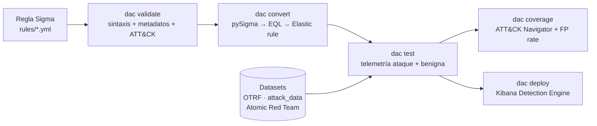

# Detection-as-Code

Pipeline de ingeniería de detección: reglas **Sigma** versionadas en git, validadas y **probadas en CI contra telemetría de ataque real**, convertidas y desplegadas en **Elastic Security**, con informe de cobertura **MITRE ATT&CK** y tasa de falsos positivos.

> 🚧 En construcción.

## Flujo



## Estructura

| Ruta | Contenido |
|------|-----------|
| `rules/` | Reglas Sigma agrupadas por táctica ATT&CK |
| `tests/cases/` | Manifiesto de test por regla (datasets que deben / no deben disparar) |
| `tests/datasets/` | Telemetría normalizada a ECS (`attack/`, `benign/`) |
| `dac/` | CLI del pipeline: `validate`, `convert`, `test`, `coverage`, `deploy` |
| `pipelines/` | Pipelines pySigma propios (mapeo de campos) |
| `lab/` | Elasticsearch + Kibana en Docker |
| `scripts/` | Normalizadores de datasets y captura con Atomic Red Team |

## Inicio rápido

```bash
python -m venv .venv
source .venv/bin/activate        # Windows: .venv\Scripts\activate
pip install -e ".[dev]"
dac --help

# Lab Elastic (requiere Docker)
dac lab init
docker compose -f lab/docker-compose.yml up -d --wait
dac lab setup && dac lab check
```

Más detalles en [`lab/README.md`](lab/README.md). Convenciones de reglas: [`docs/rule-conventions.md`](docs/rule-conventions.md). Conversión a Elastic: [`docs/conversion.md`](docs/conversion.md).

## Licencia

MIT
